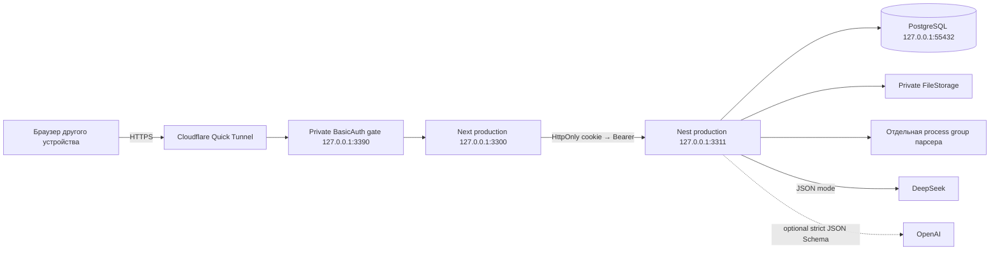
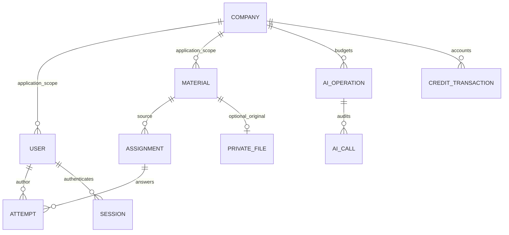

# Архитектура Практикума

Состояние на24.11.2026: один NestJS монолит, один Next.js App Router frontend и PostgreSQL/Prisma6. Логические подсистемы разделены сервисами и DI interfaces; отдельные микросервисы, CQRS bus, RAG и очередь не добавлены. Рабочие команды и итоговые проверки — [README](../README.md), [приёмка](acceptance.md).

Это текущая **временная публикация с Mac**, а не VPS hosting. Публичный адрес: https://coaches-explains-teach-hewlett.trycloudflare.com . Он зависит от работающих Mac, сети и tunnel. Публичная review БД отдельна от локальной демо/тестовой; известные demo passwords не используются. Systemd/nginx templates — будущий вариант, не свидетельство развёртывания на VPS. Подробности: [deployment](deployment.md), [ADR0011](decisions/0011-temporary-mac-review.md).

## Компоненты и данные

| Компонент | Ответственность и владелец кода |
|---|---|
| AppController / DocumentsController | HTTP, DTO/route metadata; [controller](../apps/api/src/controller.ts), [documents controller](../apps/api/src/documents/controller.ts) |
| AuthGuard | DB session, актуальный User, Allow roles; [auth](../apps/api/src/auth.ts) |
| AppService | Tenant-scoped материалы, задания, ответы, пользователи, лимиты, ledger; [service](../apps/api/src/service.ts) |
| AiService / AiProvider | Резерв, cache, валидация, retry, аудит, settlement; [ai](../apps/api/src/ai.ts), [каталог тарифов](../apps/api/src/ai-config.ts) |
| DocumentsService / DocumentParser / FileStorage | Текст из файла, приватный оригинал, проверка download; [documents](../apps/api/src/documents/service.ts), [parser](../apps/api/src/documents/parser.ts), [storage](../apps/api/src/documents/storage.ts) |
| Repository | Тонкий типизированный Prisma adapter; business predicates находятся в сервисах, отдельного DDD repository per entity нет |
| Next | Server Components для кабинетов; интерактивные формы, upload и tour — Client Components; BFF file routes держат Bearer вне браузерного кода |
| Общие контракты | Zod schemas/DTO и view types в [packages/types](../packages/types/src/index.ts); runtime package собирается в CommonJS dist |

Один [AppModule](../apps/api/src/module.ts) связывает эти providers. `Evaluation` и персональные рекомендации — validated JSON агрегат внутри Attempt, не отдельные таблицы. Company.criteria хранит стабильные40/30/30 критерии; Assignment сохраняет их snapshot. Изменения вопросов/ответов не могут задать новые критерии.

Физическая схема и семь миграций: [Prisma](../apps/api/prisma/schema.prisma). Company links — application-level; Session→User, Assignment→Material, Attempt→User/Assignment, AiCall→Operation имеют FK. Composite tenant FK/RLS нет. JSON результата сохраняет критерии/score/evidence/unsupported_claims/gaps/feedback/recommendations/personal_material.

## Аутентификация, роли и изоляция

BasicAuth gate допускает только проверяющих к transport; он не определяет компанию или роль приложения. Затем пользователь входит в собственный app account. Один User принадлежит одной Company; SUPER_ADMIN.companyId=null. Отдельного переключения tenant по client header/body нет.

256-bit opaque token хранится в HttpOnly cookie Next, SHA256 digest — в Session, срок API session24ч; logout отзывает запись. Cookie имеет Secure в production и SameSite=Lax. Frontend proxy проверяет наличие cookie, а не роль/подлинность; Server Components вызывают защищённый API, AuthGuard на каждом запросе проверяет сессию и role из БД. Это сознательное упрощение относительно дублирования role logic в Next middleware.

| Роль | Доступ |
|---|---|
| OWNER | Материалы/генерация/ответы своей компании, team/results, создание MANAGER/EMPLOYEE, лимиты, баланс/Demo topup |
| MANAGER | Материалы/генерация/ответы, результаты и сотрудники компании для обзора; без создания пользователей/изменения лимитов/пополнения |
| EMPLOYEE | Материалы/задания/файлы компании, собственные attempts и AI operations; без users/ledger списка |
| SUPER_ADMIN | Отдельный глобальный financial ledger; tenant learning endpoints не разрешены |

Сервисы получают companyId только из User сессии. Идентификатор material/assignment сначала ищется внутри этого tenant; download проверяет id+companyId до обращения к storage. AttachmentKey удаляется из upload/dashboard/assignment view. Employee attempts дополнительно ограничены userId. Hash AI включает companyId и userId. Эти границы проверяют HTTP/PW negative cases; добавление новой Prisma query требует tenant review, один DB role сам их не обеспечит. Отдельный итог tenant review — в [приёмке](acceptance.md).

## Поток обучения и файлов

1. OWNER/MANAGER добавляет текст60–12000 символов или документ до5МиБ.
2. TXT/Word/PDF parser проверяет формат и извлекает текст; OCR нет. DOCX XML/ZIP не извлекается на диск; PDF/DOC/DOCX работают вне event loop в ограниченной process group. Превышение текста/ресурсов — явный отказ, не усечённый материал.
3. Приватный оригинал сохраняется за FileStorage; в Material — текст и attachment metadata. Перед генерацией показан полный извлечённый текст. Binary файл в LLM не отправляется.
4. Генерируется один практический кейс с конспектом/вопросом/evidence. Сотрудник отвечает содержательно.
5. Единый evaluation AI response содержит критерии, score, цитаты, пробелы, объяснение и персональный учебный текст. Руководитель видит результаты компании, сотрудник свои.

Обязательные строки AI непустые после trim. Цитаты — точные подстроки source; ненулевой score без evidence, неправильные ids/max/sum критериев не публикуются. Grounding не доказывает всю семантическую правильность рекомендаций: решение по сотруднику остаётся за человеком. Ограничения парсеров и ресурсные границы: [материалы](material-files.md), [ADR0012](decisions/0012-private-document-materials.md).

## AI и денежные операции

Активный реальный provider DeepSeek `deepseek-flash`: JSON mode + переданные Zod-generated schema/example + локальная строгая валидация. Серверной гарантии strict JSON Schema у него нет; это [согласованное изменение](decisions/0010-deepseek-and-internal-tariff.md). OpenAI adapter сохраняет strict json_schema, но его успешный live сценарий не подтверждён из-за отказа по балансу. Фикстуры включаются только тестовым DI.

- Core input ≤200000 UTF8 bytes, source ≤12000/answer ≤8000 символов. Полный provider body (schema/system/retry включены) ≤200000 байт до резерва. Output ≤4096 tokens, temperature0 для оценки и0.2 генерации; до2 retry после невалидного ответа.
- Hash содержит tenant/user/kind/source/answer/criteria/provider/requested model/tariff/schema version (сейчас3). SUCCESS возвращает cache; FAILED не повторяется автоматически; PENDING/UNKNOWN блокируют replay.
- Короткая transaction атомарно резервирует200000 company credits и user.spent. Provider call вне DB transaction. Уникальный hash/revision CAS защищают duplicate/REJECTED retry, включая ABA; ledger keys содержат reservation UUID.
- Каждый ответ с usage, включая INVALID, получает AiCall и целочисленную стоимость. `model` — requested catalog alias, `responseModel` — возвращённый id (исторический null допустим); cached tokens входят в input, не добавляются второй раз.
- Settlement возвращает R−C текущего раунда, а Operation.cost накапливает стоимость всех раундов. Assignment/Attempt upsert по unique operationId допускает безопасное завершение после SUCCESS/cache.
- Подтверждённые400/401/403/404/422/429 → REJECTED/refund unused reserve; network/408/409/5xx/unknown usage → UNKNOWN с удержанием. Crash может оставить PENDING. Нулевые unknown usage поля — sentinel, не доказанная нулевая стоимость.

Тариф и арифметика: [ADR0005](decisions/0005-billing.md). Сверка: [runbook](reconciliation.md). Полной distributed transaction с провайдером и автоматического crash reconciler нет.

## Эксплуатация и UI

Review сейчас включает регистрацию и Demo topup **за приватным gate** через явные flags. Production defaults оба запрещают; registration создаёт новую компанию с0 credits. Реальные платежи/email не подключены. Admin показывает глобальные агрегаты за всё время, последние200 transactions/100 calls и последние100 operations плюс **все** PENDING/UNKNOWN. Tenant dashboard history ограничена последними100 записями.

Driver.js tour запускается для первого посещения userId в браузере, доступен повторно, пропускает отсутствующие/скрытые разделы роли, поддерживает keyboard/Escape/reduced motion. Он не меняет роли/баланс/учебные результаты; localStorage хранит только seen flag. [ADR0013](decisions/0013-role-aware-onboarding.md).

Compiled API/common package проверены на Node22.23.5 smoke; полный текущий Mac runtime проверялся на Node25.9. Backup — paired DB dump + uploads archive + SHA manifest, восстановление в отдельную БД с authenticated download hash проверено дважды. Автозапуск/systemd/nginx, offsite backup и постоянный SLA для временного Mac URL не заявлены.

Источники Context7 и owning-source: [Nest DI/guards](https://github.com/nestjs/docs.nestjs.com/blob/master/content/fundamentals/execution-context.md), [Next Server Actions/origins](https://nextjs.org/docs/app/api-reference/config/next-config-js/serverActions), [Prisma transactions](https://www.prisma.io/docs/orm/prisma-client/queries/transactions), [DeepSeek JSON mode](https://api-docs.deepseek.com/guides/json_mode), [Zod strings](https://zod.dev/api?id=strings). Свежие результаты проверок — [project audit](project-audit.md).

Task-aware assessment V2, legacy compatibility и резерв195669≤200000 описаны в [ADR0014](decisions/0014-task-aware-evaluation.md).

Для бесплатного cloud review добавлен opt-in `PostgresFileStorage`: оригиналы хранятся в PostgreSQL `bytea`, в том же интерфейсе FileStorage. Локальный default не меняется. Это сохраняет файлы при перезапуске Render Free без платного диска. [Конфигурация и ограничения](render-cloud-source.md).
