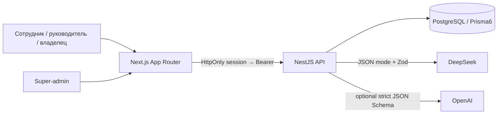
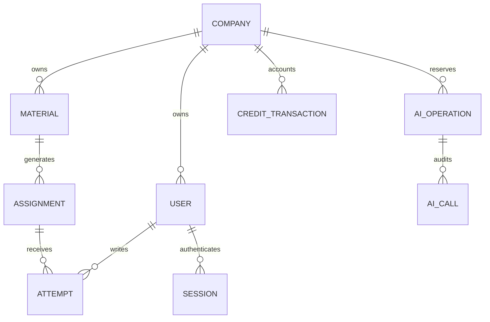

# Архитектура

Монолит Nest: Controller принимает Zod DTO; AppService управляет use cases; Repository — тонкий типизированный Prisma adapter. AuthGuard проверяет opaque сессию из БД и Allow metadata на каждом endpoint. AiService резервирует бюджет и применяет схемы/grounding. AiProvider, PaymentProvider, NotificationSender — DI границы. Один AppModule достаточен для этого объёма. Next Server Components получают данные без cache, BFF держит токен в HttpOnly cookie, proxy ограничивает неавторизованный вход. Браузер не получает ключи провайдеров.

## Изоляция
companyId приходит из актуального User сессии, не тела запроса. Все tenant чтения ограничены companyId. Сначала ищем доступный material/assignment, затем создаём relation. Employee видит только свои attempts и operations; managers видят компанию, owner управляет пользователями/лимитами/балансом. SUPER_ADMIN имеет отдельный endpoint и не может использовать tenant routes. Prisma доступен только backend, роль БД не разделяет tenants. Следовательно новые запросы требуют tenant review; RLS не заявлен.

## AI и деньги
1. Вход ограничен 12000/8000 символами материала/ответа; общий serialized prompt ≤200000 UTF8 байт. Ничего не обрезаем молча.
2. Hash включает tenant/user/kind/материал/ответ/criteria/provider/model/tariff/schema version. SUCCESS возвращается из БД; PENDING/UNKNOWN запрещают повтор; FAILED после исчерпания проверки не вызывает API снова. REJECTED допускает новый раунд с revision CAS, защищающим от устаревшего конкурентного запроса и ABA.
3. Короткая SQL transaction атомарно уменьшает company balance на200000 и увеличивает user.spent; условные UPDATE не допускают перерасхода баланса/лимита. Уникальный hash и revision откатывают проигравший duplicate reserve; ledger keys содержат уникальный reservation UUID.
4. Выбранный реальный провайдер вызывается вне transaction. DeepSeek JSON mode получает Zod-generated schema и пример; OpenAI optional adapter использует strict JSON Schema. На каждый известный ответ сохраняются usage/cached tokens, целочисленная стоимость внутреннего тарифа, latency, JSON и VALID/INVALID. Каждая платная неудачная валидация учитывается. Provider/model/tariff и actual responseModel зафиксированы в аудите; исторический actual model может быть null.
5. Zod проверяет форму; exact evidence substring, непустые цитаты при score>0, точные criteria ids/max, сумма score. Максимум три вызова (2 retries). Критерии компании сохраняются snapshot в assignment.
6. Settlement transaction возвращает неиспользованный резерв и обновляет spent, ledger,operation result. Успешный operation и его assignment/attempt связаны уникальным operationId; повтор запроса безопасно завершит создание use-case записи после сбоя процесса.
7. Известные отказы400/401/403/404/422/429 освобождают неиспользованный резерв, сохраняя ранее оплаченные ответы и безопасные status/code. При сетевом сбое,408/409/5xx или неизвестном usage оставляем UNKNOWN; повтор не вызывает модель. Crash может оставить PENDING. Нужна ручная сверка. AiCall USAGE_UNKNOWN имеет нулевые поля usage как sentinel, не утверждение нулевой стоимости; UI показывает неопределённую сумму.

Консервативный резерв200000: базовая граница трёх вызовов при200000 входных tokens и1500 выходных —185400 кредитов по самому дорогому поддерживаемому тарифу, плюс14600 на фиксированный system/schema/example/retry overhead. Реальные входы дополнительно ограничены длиной текста. DeepSeek внутренний тариф:0.30/0.006/1.20USD за1M uncached/cached/output tokens, не vendor invoice. Смена модели/тарифа требует ADR и проверки резерва. Balance доступен после резерва; spent включает незавершённые резервы. Подробности: ADR0010.

Company links application-enforced; материал/задание/ответ/сессия имеют Prisma relation FK. Резерв/settlement/topup имеют уникальные ledger keys. UI баланс не является отдельной платёжной системой.
