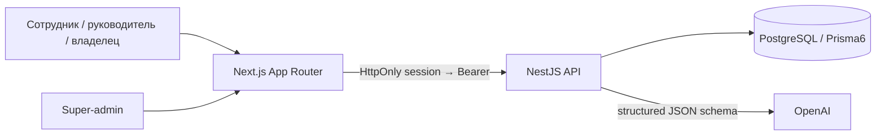
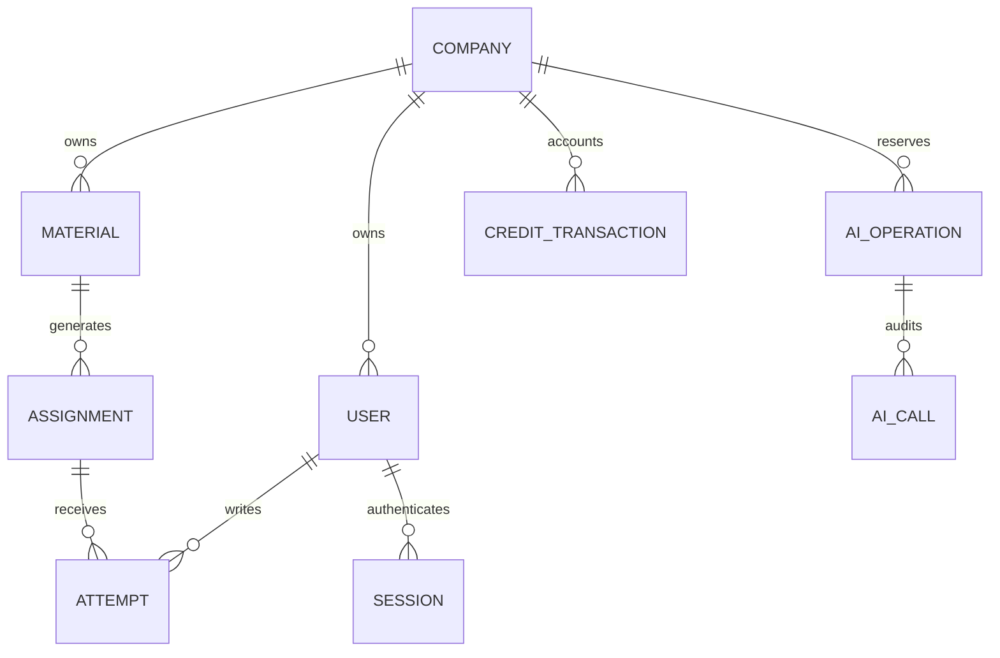

# Архитектура

Монолит Nest: Controller принимает Zod DTO; AppService управляет use cases; Repository — тонкий типизированный Prisma adapter. AuthGuard проверяет opaque сессию из БД и Allow metadata на каждом endpoint. AiService резервирует бюджет и применяет схемы/grounding. AiProvider, PaymentProvider, NotificationSender — DI границы. Разделение по функциональным модулям не добавлено: один AppModule достаточно для этого объёма. Next Server Components получают данные без cache, формы интерактивны, BFF держит токен в HttpOnly cookie. Browser не получает OpenAI ключ.

## Изоляция
companyId приходит из актуального User сессии, не тела запроса. Все tenant чтения ограничены companyId. Сначала ищем доступный material/assignment, затем создаём relation. Employee видит только свои attempts и operations; managers видят компанию, owner управляет пользователями/лимитами/балансом. SUPER_ADMIN имеет отдельный endpoint и не может использовать tenant routes. Prisma доступен только backend, роль БД не разделяет tenants. Следовательно новые запросы требуют tenant review; RLS не заявлен.

## AI и деньги
1. Вход ограничен 12000/8000 символами материала/ответа; общий serialized prompt ≤200000 UTF8 байт. Ничего не обрезаем молча.
2. Hash включает tenant/user/kind/материал/ответ/criteria/model/schema version. SUCCESS возвращается из БД; PENDING/UNKNOWN запрещают повтор; FAILED не вызывает API снова.
3. Короткая SQL transaction атомарно уменьшает company balance на100000 и увеличивает user.spent; условные UPDATE не допускают пересхода баланса/лимита. Уникальный hash откатывает проигравший duplicate reserve.
4. OpenAI вызывается вне transaction. На каждый известный ответ сохраняются usage, стоимость ceil(input×0.15+output×0.60) microUSD, latency, JSON, VALID/INVALID. Каждая платная неудачная валидация учитывается.
5. Zod проверяет форму; exact evidence substring, непустые цитаты при score>0, точные criteria ids/max, сумма score. Максимум три вызова (2 retries). Критерии компании сохраняются snapshot в assignment.
6. Settlement transaction возвращает неиспользованный резерв и обновляет spent, ledger,operation result. Успешный operation и его assignment/attempt связаны уникальным operationId; повтор запроса безопасно завершит создание use-case записи после сбоя процесса.
7. При сетевом сбое или неизвестном usage оставляем UNKNOWN и весь резерв; повтор не вызывает модель. Сбой процесса может оставить PENDING. Нужна ручная сверка, автоматического бесплатного повтора нет. AiCall USAGE_UNKNOWN имеет нулевые поля usage как sentinel, не утверждение нулевой стоимости.

Консервативный резерв: токен не короче одного UTF8 байта; 200000 входных байт + system/retry overhead <3000 байт,1500 выходных токенов ×3: <94100 microUSD. Резерв100000. Pricing fixed known model; смена модели требует ADR/новой цены/пересмотра резерва. Показанный balance — доступный после резерва, spent включает незавершённые резервы.

Company links application-enforced; материал/задание/ответ/сессия имеют Prisma relation FK. Резерв/settlement/topup имеют уникальные ledger keys. UI баланс не является отдельной платёжной системой.
